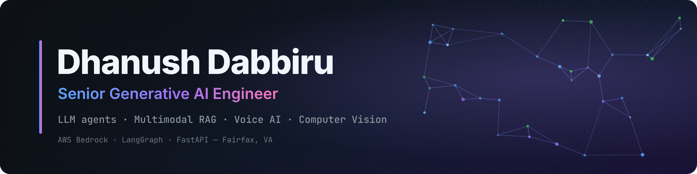

  

  
  
  
  

### Hi, I'm Dhanush 👋

**Senior Generative AI Engineer** in Fairfax, VA. I build production LLM systems: tool-calling agents, RAG with persistent memory, multimodal video AI, real-time voice AI, and computer vision, deployed on AWS.

- 🔭 **Now:** Senior Generative AI Engineer at **ClarityPath AI** (Clarity Sidekick) · Foundational Senior Generative AI Engineer at **AreaProbe** (SpeakCanary)
- 🎓 **M.S. Computer Science (Machine Learning)**, George Mason University, 2025 · **B.S. Computer Science**, GITAM University, 2023
- 📜 AWS Certified AI Practitioner · AWS Certified Cloud Practitioner · Microsoft Azure AI-900

### 🧠 What I work on

| Area | What I've shipped |
|---|---|
| **LLM agents** | LangGraph model/tool loops with parallel tool execution, streamed responses, and memory-aware conversations (AWS Bedrock, Gemini, Claude, Groq) |
| **RAG & memory** | Multimodal RAG over video frames with Amazon Nova embeddings and Pinecone; durable memory across DynamoDB, PostgreSQL, Pinecone + S3, and Redis |
| **Computer vision** | Multi-camera pipelines: OpenCV motion detection, YOLOv12n / YOLOE detection, InsightFace facial recognition |
| **Voice AI** | Real-time phone and app voice agents: Deepgram Nova-3 STT, Cartesia Sonic TTS, Twilio / Telnyx, WebSockets, barge-in handling |
| **Cloud & apps** | FastAPI on AWS (EC2, ECS, ECR, S3, Lambda), Docker, Terraform; React/TypeScript and Flutter clients |

### 🚀 Selected work

> Most of my production work lives in private company repositories, so these are described here rather than linked.

- **SpeakCanary** · AreaProbe: multimodal video intelligence for 8–12 concurrent camera streams (motion, person, custom-object and face detection) with alerts in ~2–3 s, and semantic search over 10K+ frames with sub-second retrieval.
- **Clarity Sidekick** · ClarityPath AI: LangGraph assistant on AWS Bedrock and Gemini with an 11-type durable-memory architecture; rolling summaries and memory caching cut repeated context/token usage by ~30–40%.
- **AfterBuy**: AI receipt-management app (AWS Bedrock + LLaMA 4 Scout, FastAPI, Flutter) that turns receipt photos into searchable purchase records.
- **Savoas** · independent: real-time AI voice receptionist for salons (LangGraph, Groq GPT-OSS, FastAPI, Telnyx/Twilio, Deepgram, Cartesia, Pinecone, Redis) with booking, calendar and payment tools.
- **DKVR**: legal document workspace with multimodal ingestion, RAG-grounded chat with citations, and section-by-section drafting (AWS Bedrock, Pinecone, LangGraph, Celery).

### 🛠️ Tech stack

  

  
  
  
  
  
  
  
  
  
   
  
  
  
  
  
  
  
  
  

### 📊 GitHub activity

> Includes my private-repo contributions (counts only; private code and repo names stay private).

  

  

  <picture>
    <source media="(prefers-color-scheme: dark)" srcset="https://raw.githubusercontent.com/dkvd648/dkvd648/output/github-contribution-grid-snake-dark.svg" />
    <source media="(prefers-color-scheme: light)" srcset="https://raw.githubusercontent.com/dkvd648/dkvd648/output/github-contribution-grid-snake.svg" />
    
  </picture>

<!--
  OPTIONAL (after .github/workflows/stats-cards.yml has run with a GRS_TOKEN secret):

  
  

-->

### 📄 Publications

- *IoT Enabled Aqua Pond Monitoring System*, IEEE ([link](https://ieeexplore.ieee.org/document/10760944))
- *Semi-Automated Vehicle Control Using Wi-Fi*, Springer ([link](https://link.springer.com/chapter/10.1007/978-3-031-51167-7_62))

---

Open to Generative AI / AI Engineer roles: LLM agents, multimodal RAG, VLMs, computer vision, voice AI · <a href="mailto:kasiviswanadhdhanushdabbiru@gmail.com">kasiviswanadhdhanushdabbiru@gmail.com</a>

